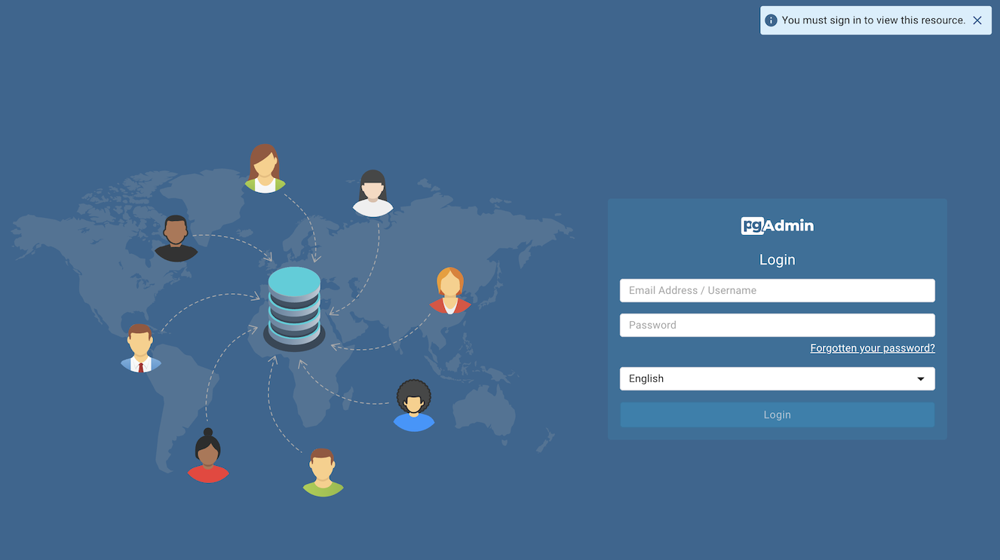
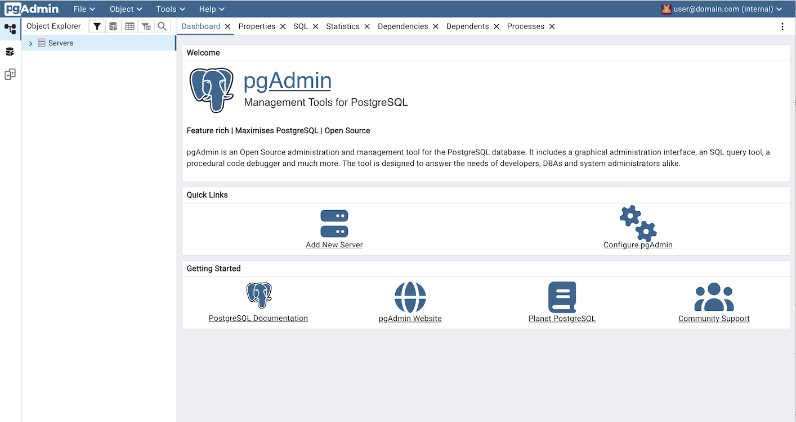
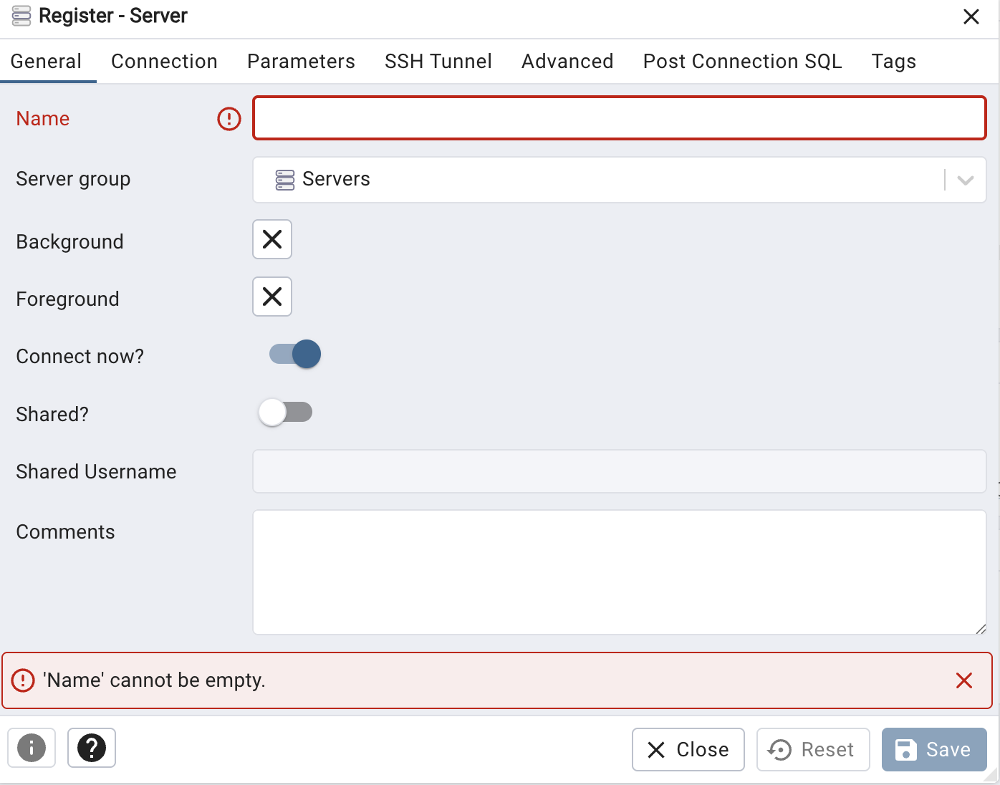
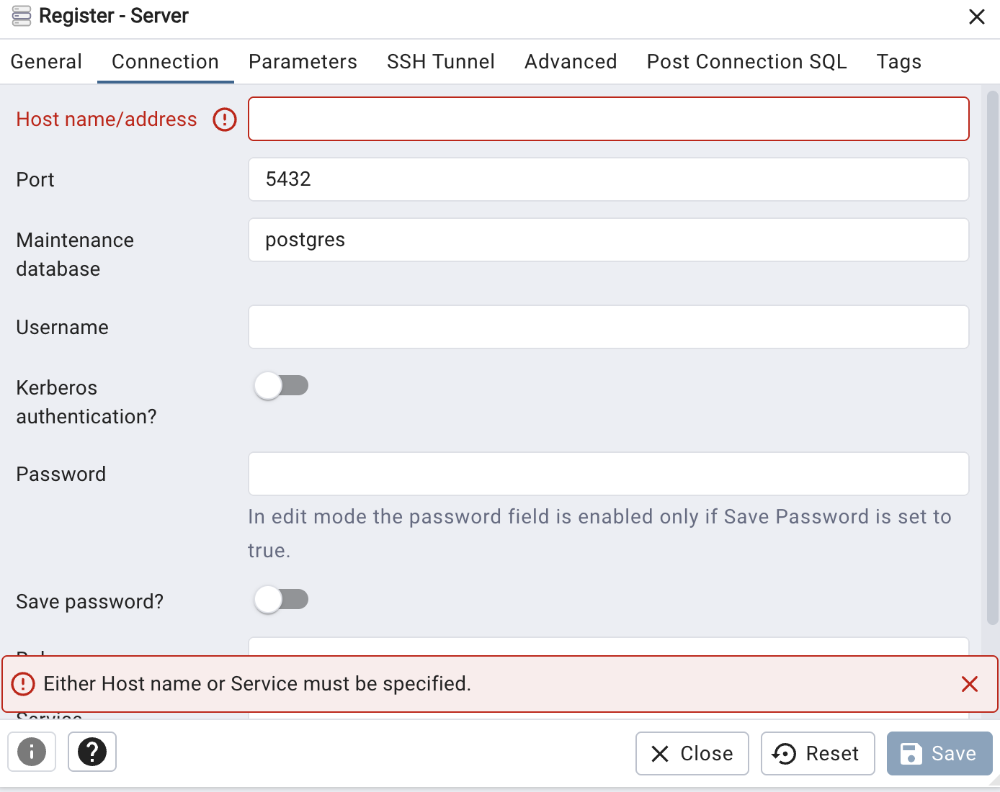
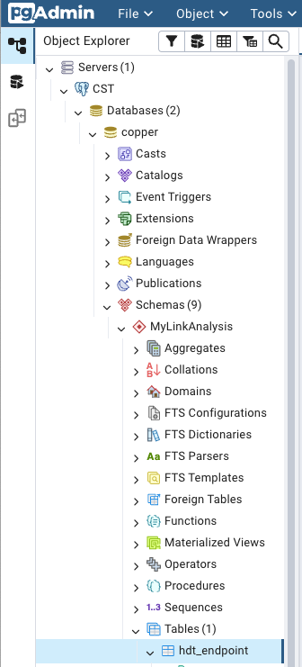

# Time-Series Data Logging
Data management is generally a significant challenge when running a co-simulation. Traditionally, the data being generated is stored in a format native to the simulation tool and typically as a file on disk. This not only produces a growing set of files as the number of federates grows but also can require dedicated tooling to access and correctly parse the data for each simulation tool. The management of this data and its pre- and post-processing is challenge and makes working on teams that need access to the data difficult.

To address these challenges, CoSim Toolbox (CST) provides data management with two data stores for time-series data: a Postgres server and a local directory for CSVs; the Postgres server and an inspector ("pgadmin") are included as part of CST's persistent services and are implemented as Docker containers. CST provides identical APIs ("backends") for accessing both. 

:::{important}
Though the backends use identical APIs, the nature of the data storage as implemented is quite different. The Postgres data store, if implemented on a server that the analysis team can all reach, becomes a centralized data repository that all team members can access. Conversely, the CSV data store is local-only and designed for local development, testing, or running co-simulations whose data doesn't need to be shared. The CSV data store is generally faster and harder to share.
:::

After specifying which backend and data store to use, data can be automatically collected from federates by two separate means. For federates based on CST's Federate class, the data collection happens automatically, behind the scenes. For federates developed otherwise, a separate logger federate can be included in the federation to do the data collection. In either case, the data that is collected is all of that which is transmitted to the federation via HELICS (configuration is possible to limit the collected data to a subset of this). 

After the data has been collected and is needed for post-processing, the CST APIs take care of extracting the data from the data store and presenting it as a Pandas DataFrame, one of the most common data formats used.

This approach to data collection provides several benefits:
- Data collection is easily configured simply by creating a new HELICS output
- Data storage is handled transparently without any user intervention 
- Data format is standardized and independent of the simulation tool that created it
- When using the Postgres backend, data can be accessed by anybody with access to the database, making sharing data much easier

## Data schema
Independent of the backend use, time-series data is stored in a tabular format. The columns of the data are as follows:
- "real_time" - timestamp of data collected in an ISO 8061 format
- "sim_time" - ordinal simulation time in seconds where the initial simulated time is "0". (This is the native format that HELICS uses for time management.)
- "scenario" - name of the scenario used for this particular run (see the [Terminology page](./Terminology) for further details)
- "data_name" - name associated with this particular data collected typically formatted as "<Federate name>/<output name>"
- "data_value" - value collected for the specified output at the specified simulation time

To increase effectiveness of the Postgres data store, CST sorts the data by the HELICS data type, storing each data type in its own data table (this is called "third form normal"). If you use a tool to inspect the Postgres database or look at the files as written to disk when using the CSV backend, you'll see that the names of tables/files indicate the data type stored (_e.g._ "hdt_bool", "hdt_complex", "hdt_double"). 

## Using the CST Time-Series APIs
:::{note}
There is a comprehensive documentation on the time-series backend APIs provided by CST in the [API documentation section](./References.rst), and we're not going to replicate it all here. 
:::

One use of the time-series APIs is to preload the data-store with data one or more federates need during a co-simulation. The task would only need to be done once prior to running the co-simulation and all subsequent runs would be able to access that data in the data store.

A more common use of the time-series APIs is having an analyst performing post-processing on one or more scenarios that have been previously run. In that case, the analyst would only need to read data out of the time-series data store (and potentially the metadata data store to use the various parameter values stored there).

### TSRecords
The atomic unit of time-series data is realized as in the "TSRecord" class; this class exists to ensure the data format needed for the time-series backends is maintained. An instance of the TSRecord class can be thought of as a row or record that ends up in the time-series data store. Generally, when adding data to the data store, individual TSRecords are constructed and added to a Python list. This list is then used by the time-series APIs to add the data in all of those records to the data store.

### Example

The following example shows how to add data to TSRecord instances, add those instances to the data store, and retrieve that same data out of the data store. Again, this is not a comprehensive list of the APIs for handling time-series data; those can be found in the [API documentation section](./References.rst).

```python
from cosim_toolbox.dbms import create_timeseries_manager
from cosim_toolbox.dbms import TSRecord
from datetime import datetime
import time as t

# Creating a list of dummy time-series records 
# To make the data slightly consistent, we use the current real-time as the CST "real_time" timestamp
# and then pause for one second after creating the record. The CST "sim_time" is ordinal time and will
# have the same value as the CST "data_value" since they both increment by one each second.
records = []
for dummy_value in range(5):
    records.append(TSRecord(
        real_time=datetime.now(), 
        sim_time=dummy_value, 
        scenario="example_scenario", 
        federate="dummy_fed", 
        data_name="dummy_value", 
        data_value=dummy_value)
    )
    t.sleep(0.2)

# Setting up the time-series data manager that allows us to write and read data from the CSV data store
with create_timeseries_manager(backend="csv", location="", analysis_name="example_analysis", database="cst") as mgr:
    # Add our made-up data to the data store
    mgr.write_records(records=records)

    # List the scenarios in the data store (should show "test_scenario" as being one)
    print(f"Scenarios: {mgr.list_scenarios()}")

    # List the data types in the data store 
    print(f"Data types: {mgr.list_data_types()}")

    # Read all the data in the data store where the "scenario_name" is our scenario ("test_scenario)
    # Returns this as a Pandas DataFrame
    df = mgr.read_data(scenario_name="example_scenario")
    print(f"Data: {df}")
```

Running this example will produce the following results (with real_time timestamps that correspond to when you run it.):
```shell
$ python ts_examples.py
Scenarios: ['example_scenario']
Data types: ['hdt_integer']
Data:                    real_time  sim_time          scenario   federate    data_name  data_value
0 2025-09-24 06:06:45.705904         0  example_scenario  dummy_fed  dummy_value           0
1 2025-09-24 06:06:45.912023         1  example_scenario  dummy_fed  dummy_value           1
2 2025-09-24 06:06:46.116081         2  example_scenario  dummy_fed  dummy_value           2
3 2025-09-24 06:06:46.317088         3  example_scenario  dummy_fed  dummy_value           3
4 2025-09-24 06:06:46.520976         4  example_scenario  dummy_fed  dummy_value           4
```

## Inspecting Time-Series Data
Generally, the best way of inspecting the time-series data is through the provided CST APIs but there are times (_e.g._ debugging) when looking at the data through alternative means can be helpful; this section explains how to do so.

### CSV Backend (local files)
The CSV backend for time-series writes the data produced by the federates to special folders on the local disk where the federate runs. The "data_store" folder is created in the same directory as the 'federate' itself (if it doesn't already exist) and inside that (if it doesn't exist), a folder of the analysis name is created. Lastly, inside the analysis folder, a folder for each federate running in that directory is created. Inside this folder is one file for each data type being written; these file names correspond exactly to the table names in the Postgres data store (_e.g._ "hdt_bool" has the same data as the file "hdt_bool.csv"). The complete folder hierarchy looks like this:

```shell
├── data_store
│   └── <analysis name>
│       ├── <federate 1 name>
│       │   ├── hdt_boolean.csv
│       │   ├── hdt_complex.csv
│       │   ├── hdt_double.csv
│       │   ├── hdt_endpoint.csv
│       │   └── hdt_string.csv
│       └── <federate 2 name>
│           └── hdt_endpoint.csv
```

If you want to manually look through the data without using the CST APIs for accessing it, you can navigate through this folder hierarchy and open any of these files with any tool you desire. 

:::{danger}
The preservation of the hierarchy and the structure of these files is necessary for the CST's CSV backend to continue to operate correctly. Modification and/or relocation of these files in any way puts the operation of the backend at jeopardy so tread carefully.
:::

### HDF5 Backend (local files)
The "hdf5" backend (`create_timeseries_manager("hdf5", analysis_name)`, or `use_data_db="hdf5"` for CST federates) stores all of the data of a federate, of every data type, in one HDF5 file. It requires the `h5py` package, which is installed with CST. Like the CSV backend, it is a local data store:

```shell
├── data_store
│   └── <analysis name>
│       ├── <federate 1 name>.h5            # all data of federate 1
│       ├── <federate 1 name>.h5.lock       # lock file used by writers; leave in place
│       ├── <federate 1 name>.h5.segments/  # recently written data, folded into the .h5 file
│       └── <federate 2 name>.h5
```

Inside each file there is one group per data type ("hdt_double", "hdt_endpoint", ...), with one dataset per column of the data schema plus a `nrows` attribute:

| Column | HDF5 type |
|---|---|
| real_time | int64, nanoseconds since 1970-01-01T00:00:00 UTC |
| sim_time | float64 |
| scenario, data_name | variable-length UTF-8 string |
| data_value | bool, int64, float64, complex128, UTF-8 string, variable-length float64 or complex128 arrays, or (endpoints) variable-length bytes |
| receiving_federate, receiving_endpoint (endpoints only) | variable-length UTF-8 string, with a `null_mask` column distinguishing `None` from `""` |

Values are stored without loss: integers keep their full 64-bit range, doubles keep NaN, infinities and the sign of zero, complex values keep both parts, and endpoint payloads keep their original `str` or `bytes` type. A record that cannot be stored exactly (an integer outside the int64 range, a non-UTF-8 string, a string with an embedded NUL character, a timestamp outside 1677-09-21 to 2262-04-11, an unsupported data type such as `hdt_named_point`, `hdt_time` or `hdt_json`) is rejected with a logged error instead of being converted. Numeric strings logged for numeric publications (for example "(1+2j)" for a complex output, which HELICS itself converts) are parsed with Python's `int()`, `float()` or `complex()` and stored as numbers. `write_records()` rejects the whole list before anything is written; `flush()` stores the valid records, keeps the rejected ones in `writer.rejected` and returns `False`. The HELICS type aliases "float", "int", "int64", "bool", "double_vector" and "complex vector" are accepted. Naive `datetime` values are taken to be UTC, as in the Parquet backend. `real_time` is stored in nanoseconds: `datetime` values keep their microseconds and `pandas.Timestamp` values their nanoseconds.

Federate names may contain characters such as "/" (for example the endpoint names logged by the logger federate). They are percent-encoded in file names, so "Battery/EV1" is stored in "Battery%2FEV1.h5", and `list_federates()` returns the original names. Two federate names that differ only in letter case are refused, because they would share a file on Windows and macOS.

Data integrity: published files are never modified in place. Each `flush()` writes the new records of each federate to a new segment file under a temporary name, verifies it, calls `fsync`, and renames it into place; segments are folded into the federate's `.h5` file by writing a complete new copy and atomically replacing the old one, after `max_segments` flushes and when the manager disconnects. Writers and readers of a federate coordinate through an operating-system lock on its `.lock` file: writers hold it while committing a batch or consolidating, and readers hold it only while opening the files of their snapshot, so a read returns every batch committed before it started and never a partial batch. Several processes may write to the same analysis, and to the same federate, at the same time. `delete_federate_data()` waits for active writers and readers. Damaged or unexpected files make `read_data()` raise `HDF5StoreError` rather than return partial data.

Commits are per federate. When one `flush()` holds records for several federates (for example in the logger federate), each federate's records are committed separately, so after a crash or an I/O error some federates can have the batch and others not; `flush()` returns `True` only when all of them are committed. With `durable=True` (the default), a flush returns `True` only after the new files, the directories containing them, and the analysis directory's entry in `location` have been flushed to disk with `fsync` (directories above `location` are not); if any `fsync` fails, the flush returns `False` and the retry repeats the `fsync` calls before acknowledging the records. If a flush fails on I/O, its records stay pending in that writer and are committed, without duplicates, by the next `flush()` or `write_records()` call of the same writer (`write_records()` commits the pending batch first and writes nothing if that fails). Records that cannot be stored are not retried: they are listed in `writer.rejected` and the flush returns `False`. Records that were buffered or pending when the process ends are lost, as with the other backends; a `write_records()` call that fails is not retained, and calling it again with the same records can duplicate those already committed for some federates. CST's `Federate` class does not check the result of `flush()`, so such failures appear only as logged errors.

:::{important}
These properties were tested on Linux (ext4) by killing writer processes at every step of the commit protocol and at random times, and by pausing readers during consolidation and deletion in other processes. They are not a guarantee for power loss or operating-system crashes, which depend on the filesystem honouring `fsync` and atomic rename, and were not tested on network filesystems (NFS, SMB, Lustre) or macOS (which uses `F_FULLFSYNC`). The backend requires POSIX file locking: on platforms without it, such as Windows, `connect()` raises `HDF5StoreError` and the HDF5 tests are skipped. Locks are advisory: tools that modify the files directly (for example HDFView in write mode) bypass them.
:::

`backup_analysis(path)` writes one consolidated, verified `.h5` file per federate to `path`. The destination must not exist, be an empty directory, or hold an earlier HDF5 backup of the same analysis (only `<federate>.h5` files of that analysis); otherwise the backup is refused and nothing is changed. The backup is assembled in a temporary directory next to `path` and then replaces it, so the destination holds exactly the federates that exist at the time of the backup: a federate deleted since an earlier backup to the same path is no longer in it, and if every federate has been deleted the earlier backup becomes an empty directory (with no data and no existing destination, nothing is created). If `backup_analysis` returns `False`, `path` is put back as it was before the call, including when the new backup was already in place but could not be synced to disk. If that restore cannot itself be completed and synced, nothing is deleted: the earlier backup and the new copy are kept in hidden `.<name>.*` directories next to `path`, and the log names them. Each federate's file is copied while holding that federate's lock and is therefore a committed state, but different federates can reflect different moments of a running simulation. (The CSV and Parquet backends instead copy files into the destination and keep files already there.) A backup can be read by giving its parent directory as `location` and its directory name as `analysis_name`; reading an analysis that has no `.lock` files creates none.

Options, set in `cosim_toolbox.h5_data_db` or passed as keyword arguments to `create_timeseries_manager`:

| Option | Default | Meaning |
|---|---|---|
| location | "./data_store" | directory holding analysis folders |
| compression | "gzip" | "gzip", "lzf" or None, for the consolidated file |
| compression_opts | 4 | gzip level |
| chunk_rows | 16384 | HDF5 chunk length in rows |
| max_segments | 32 | flushes between consolidations (1 rewrites the file on every flush) |
| lock_timeout | 60.0 | seconds to wait for another writer or reader |
| durable | True | call `fsync` before and after publishing files |

The `.h5` files can be opened with any HDF5 tool (HDFView, `h5dump`, `h5py`). Data written since the last consolidation is in the `.segments` folder until the writer disconnects; call `consolidate()` on the manager to fold it in. Do not modify the files while CST is writing to them.

### Postgres Backend (database)
The "postgres" backend for CST writes the time-series data to a Postgres database. Included in the persistent services, alongside the database itself, is a service that provides a web interface to inspect the database: "pgadmin". Configuring this service takes a little bit of work.

First, get the IP address of the pgadmin server by looking for the value of the environment variable "POSTGRES_HOST"; this is set when setting up the environment by running the `source cosim.env` in the root directory.

```shell
$ printenv | grep POSTGRES_HOST
```

The value this environment variable is set to is the IP address you can use to connect to pgadmin on port 80. Just put the following string into a web browser of your choice: `<IP address>:80`.

You should see a login screen and can use the following credentials to access pgadmin
- username: user@domain.com
- password: SuperSecret



After logging in, you'll need to connect pgadmin to the Postgres database where the data to be inspected resides. Click on the "Add New Server" button in the center pane to do so.



A dialog box will pop up on the "General" tab where the name of the server needs to be defined. Pick a name you like.



Next, go to the "Connection" tab and fill in the following values:
- "Host name/address" - Use the same IP address you used to access pgadmin
- "Username" - worker
- "Password" - worker



Click on the "Save" button and a new database should show up in the left-hand pane under the name you've defined. 

Click on the disclosure triangle for that new database, then "Databases", then "copper", then "Schemas", then the name of the analysis you're interested in. Finally, to look at the tables, open the "Tables" disclosure triangle and right-click on the table (data type) you're interested in viewing and select "View/Edit data" and pick the rows you want to view.



:::{danger}
Editing the time-series data runs the risk of the CST APIs unable to use it. Edit with care.
:::


